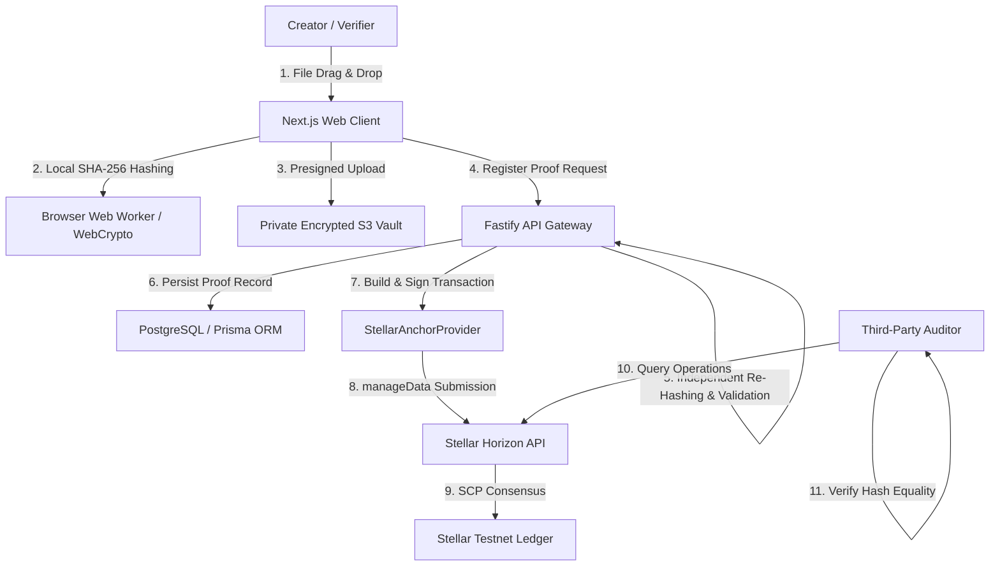
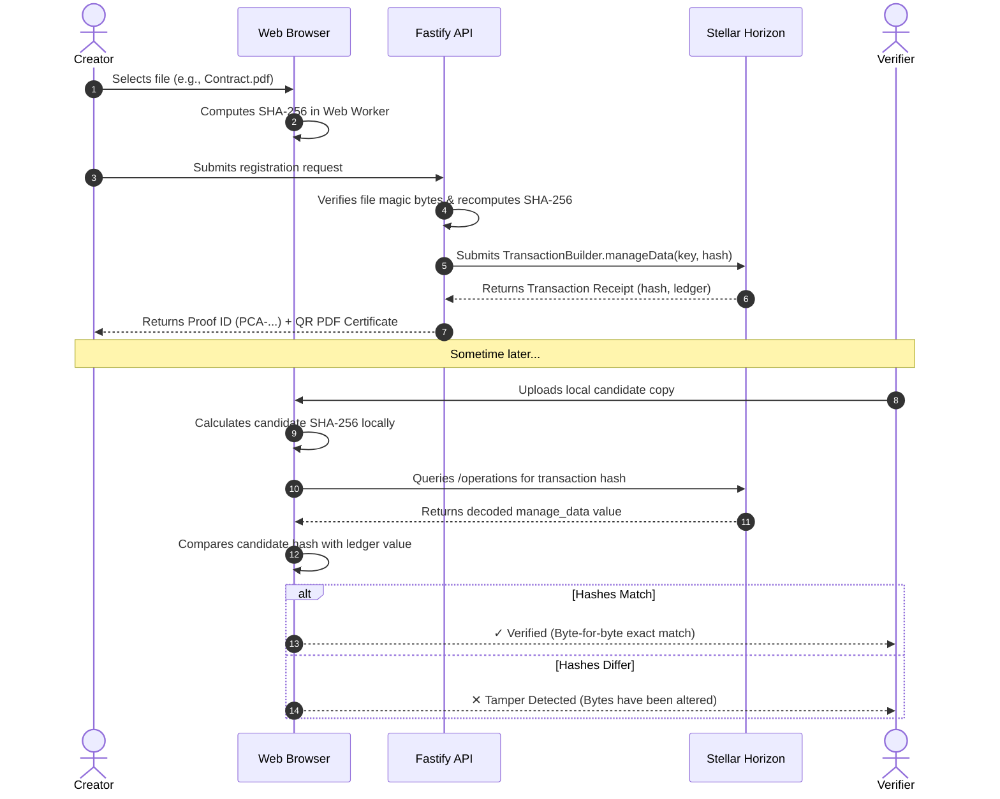

# Authivara Architecture & Design Decisions

**Document Version:** 2.0.0  
**Target Ecosystem:** Stellar Network / Soroban Smart Contracts  
**Application Architecture:** Modular Monolith (Next.js 16 Client + Fastify 5 API + Stellar Ledger Anchor)

---

## 1. System Overview

Authivara is a cryptographic evidence and digital document verification system. It enables creators, legal professionals, and software engineers to create verifiable proof that an exact sequence of bytes existed at a certified timestamp without uploading confidential content to a public ledger.

---

## 2. Stellar Architectural Decision: Native `manageData` vs. Soroban Contract

### Decision:
Authivara adopts **Stellar Native `manageData` Operations** as its primary production anchoring engine on Stellar Testnet, while maintaining a **Soroban Smart Contract implementation** (`contracts/proof_anchor/`) for advanced enterprise governance and multi-signature policies.

### Technical Justification:

| Criteria | Stellar Native `manageData` (Primary) | Soroban Smart Contract (Advanced) |
|---|---|---|
| **Simplicity & Reliability** | **Extremely high.** Uses core Stellar Consensus Protocol operations without virtual machine execution risk. | Medium. Requires Soroban host environment, WASM bytecode deployment, and SDK bindings. |
| **Transaction Cost** | **Lowest possible.** Base fee: 100 stroops (0.00001 XLM). No contract execution or metering costs. | Higher. Incurs CPU instructions, memory allocations, and state storage fees. |
| **State Expiry / TTL** | **Permanent on ledger history.** Transaction and operations remain permanently in Horizon archives. | Requires ongoing TTL extension to prevent state eviction from ledger instance storage. |
| **Queryability** | **Universal.** Any standard Horizon server or block explorer (StellarExpert) decodes and displays `manage_data` entries natively. | Requires Soroban RPC `/simulateTransaction` or contract invocation decoding. |
| **On-Chain Governance** | Single-signer authority (account keypair). | Multi-party governance, on-chain revocation voting, and automated access control logic. |

### Architectural Conclusion:
For digital document verification and evidence provenance, single-transaction `manageData` anchoring is the simplest, most reliable, and lowest-cost solution that solves the exact problem. Soroban smart contracts are retained in the codebase to support future decentralized DAO notarization and multi-party signing workflows.

---

## 3. On-Chain and Off-Chain Separation

To comply with global data protection laws (GDPR, CCPA) and preserve creator confidentiality:

1. **Strictly Off-Chain**:
   - Original document bytes (PDFs, source code, designs, audio).
   - Author personally identifiable information (PII, legal names, email addresses).
   - Storage bucket keys and access credentials.
   - Private creator notes and collaboration comments.

2. **Strictly On-Chain (Stellar Ledger)**:
   - **Data Entry Name**: `authivara-proof:<proof-id>` (ASCII string, 32 bytes max).
   - **Data Entry Value**: The 64-character lowercase SHA-256 hexadecimal content digest (64 bytes max, fitting Stellar's native 64-byte limit).
   - Ledger timestamp, sequence number, and transaction hash generated natively by Stellar consensus.

---

## 4. End-to-End Verification Lifecycle

---

## 5. Distinction of Evidentiary Claims

Authivara documentation and user interfaces strictly distinguish between the following four concepts:

1. **Document Integrity**: Proof that the candidate file's exact binary bytes match the fingerprinted digest bit-for-bit.
2. **Proof of Existence**: Proof that the specific cryptographic digest was witnessed and committed to the Stellar ledger prior to or at a specific ledger timestamp.
3. **Issuer Authenticity**: Cryptographic proof that a specific Stellar public key authorized the anchor transaction.
4. **Legal Copyright / Authorship**: Authivara **does not** adjudicate legal ownership or copyright validity. Proof records serve as verifiable evidence in legal disputes, but do not replace legal title or judicial rulings.
